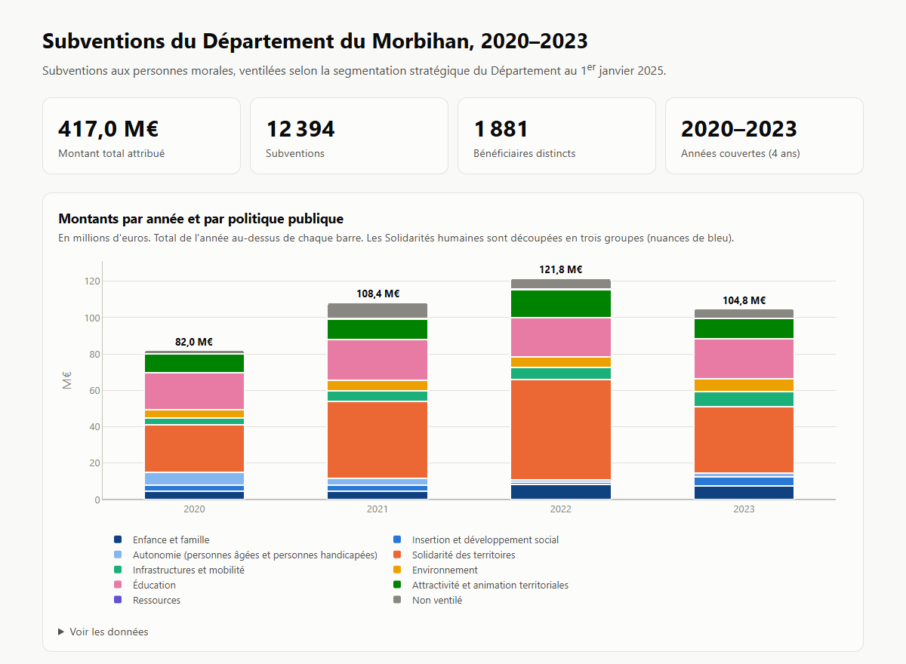

# Morbihan Department grants: monitoring dashboard



**Live dashboard:** <https://mariecourraud.github.io/subventions-morbihan/>
(GitHub Pages; the address redirects to `dashboard.html`, a single self-contained page of
about 5 MB)

The dashboard is in French, because it covers French public data. This README explains it in
English.

## Purpose

A dashboard to monitor the grants awarded by the Département du Morbihan (France), built as a
semi-automated pipeline: scripts do the repetitive cleaning, and every judgement call is recorded
in a plain CSV file that a person fills in and that the scripts then apply.

## Data

- **Source:** data.gouv.fr, *Subventions aux personnes morales*, published by the Département du
  Morbihan: <https://www.data.gouv.fr/datasets/subventions-aux-personnes-morales/>
  (downloaded on 23 November 2026)
- **Licence:** Licence Ouverte (Etalab open licence)
- **Coverage:** 2020–2023, 12,514 grants, €417.0 M in total; 1,900 beneficiary IDs in the raw
  file, 1,881 after merges (excluding €0 grants)
- **Format:** SCDL (the French national schema for grant data), `;`-separated, Windows-1252

| Year | Grants | Total amount |
|---|--:|--:|
| 2020 | 2,543 | €82.0 M |
| 2021 | 3,292 | €108.4 M |
| 2022 | 3,534 | €121.8 M |
| 2023 | 3,145 | €104.8 M |

## Pipeline

| Step | Script | Human decisions read | Output |
|---|---|---|---|
| 1. Cleaning | `clean.py` | — | `data/subventions_clean.csv`, `data/a_verifier.csv` (rows to check) |
| 2. Beneficiary merges | `fusions.py` | `ref/fusions.csv` | applied in step 3 |
| 3. Categorisation | `categorize.py` | `ref/fusions.csv`, `ref/objets_politiques.csv` | `data/subventions_final.csv` |
| 4. Renewal analysis | `renouvellement.py` | `ref/renouvellement_exclusions.csv` | `data/renouvellement_solidarites.csv`, `data/pluriannuels_solidarites.csv` |
| 5. Dashboard | `build_dashboard.py` | (uses steps 3 and 4) | `dashboard.html` |

Requires Python 3, pandas and plotly. To rebuild everything from the raw file:

```
python clean.py
python categorize.py
python renouvellement.py   # optional: prints the renewal results and writes the named lists
python build_dashboard.py
```

`python fusions.py` only regenerates a blank `ref/fusions.csv` and refuses to overwrite an
existing one, so recorded decisions cannot be lost by accident. The scripts check the decision
files they read: a policy label outside the grid or an inconsistent renewal exclusion stops the
run with an explicit error; a merge pointing to an unknown ID is reported and skipped.

`dashboard.html` is a single self-contained page (plotly embedded, works offline). Each chart has
a data table underneath, and the page follows the system's light or dark mode. On narrow screens
(phones), multi-panel charts switch to two columns, long names are shortened (full name on hover)
and the heatmap drops its type column; the desktop layout comes back when the window widens.

## What the dashboard shows

**Policy grid.** Each grant object (131 in all) is mapped to the Department's official strategic
segmentation as of 1 January 2025, on two levels: 7 public policies and 26 sector policies
(`politique_publique` / `politique_sectorielle`). Grants are classed by their *object*, never by
who receives them. Objects too generic to be classed with certainty are marked *Non ventilé*
(unallocated) rather than guessed.

| Public policy | 2020 | 2021 | 2022 | 2023 | Total (€M) | Share |
|---|--:|--:|--:|--:|--:|--:|
| Solidarités humaines | 14.9 | 11.6 | 10.8 | 14.6 | 51.9 | 12.5% |
| Solidarité des territoires | 26.2 | 42.1 | 55.0 | 36.6 | 159.9 | 38.4% |
| Infrastructures et mobilité | 3.6 | 6.2 | 6.6 | 8.0 | 24.3 | 5.8% |
| Environnement | 4.6 | 5.6 | 6.2 | 7.0 | 23.5 | 5.6% |
| Éducation | 20.3 | 22.5 | 21.5 | 21.9 | 86.2 | 20.7% |
| Attractivité et animation territoriales | 10.3 | 11.1 | 15.4 | 11.2 | 48.0 | 11.5% |
| Ressources | 0.3 | 0.3 | 0.4 | 0.1 | 1.1 | 0.3% |
| *Non ventilé* | 1.8 | 9.0 | 5.9 | 5.3 | 22.0 | 5.3% |
| **Total** | **82.0** | **108.4** | **121.8** | **104.8** | **417.0** | **100%** |

**Sections**, in order: key figures; amounts by year and policy (stacked bars); one small chart
per policy; breakdown by beneficiary type, next to a data quality and limitations box; top 15
beneficiaries; top 10 beneficiaries of each solidarity group; a heatmap of *Insertion – hors
FSE*; beneficiary renewal in the solidarity groups.

**Display choices for social policies** (the official columns are never changed):

- *Solidarités humaines* is split into three groups (`politique_affichage`): *Enfance et famille*,
  *Insertion et développement social*, and *Autonomie* (older people + people with disabilities).
- Within *Insertion*, the evolution chart and the beneficiary tables separate, grant by grant,
  *Insertion – fonds européens (FSE)* (object exactly "Subventions FSE") from *Insertion – hors
  FSE*. FSE grants are European funds managed by the Department, not only its own credits. A
  structure receiving both appears in both tables with the amount of each.
- The *Autonomie* panel adds a grey line without Morbihan Habitat, which received €1,168,389
  classed in Autonomie in 2020–2021 and none afterwards, its later grants falling under
  *Solidarité des territoires / Habitat*. Without it, Autonomie is €5.7 M instead of €6.8 M in
  2020; the two lines merge from 2022.
- The heatmap shows the top 40 beneficiaries of *Insertion – hors FSE* (97.4% of its €4.6 M) by
  year, plus a separate *Total* column: one blue scale from light to dark, logarithmic because
  yearly amounts range from €2k to €207k (amounts are not smoothed; exact euros on hover), grey
  cells for years without a grant, beneficiary type on the left and a ◆ for *probably multi-year*
  pairs. A note reminds that amounts are recorded in the year of the decision, so a multi-year
  agreement shows up once, followed by empty years, without the funding having stopped.
- In the beneficiary tables, anonymised beneficiaries are left out and counted in a note, rather
  than summed as if they were one organisation.

**Beneficiary renewal** (`renouvellement.py`), in the three solidarity groups. The unit is the
pair beneficiary × group; the total counts each organisation once. From each pair's first and
last year: *present* (2020 and 2023), *entering* (after 2020, still funded in 2023), *leaving*
(funded in 2020, last grant before 2023), *one-off* (after 2020, gone before 2023).

| 2020–2023 | Enfance et famille | Insertion et dév. social | Autonomie | Total |
|---|--:|--:|--:|--:|
| Beneficiaries in 2020 | 196 | 72 | 182 | 406 |
| Present all period | 166 | 52 | 129 | 321 |
| Entering / leaving | 45 / 30 | 11 / 20 | 32 / 53 | 80 / 85 |
| Entry rate / exit rate | 23.0% / 15.3% | 15.3% / 27.8% | 17.6% / 29.1% | 19.7% / 20.9% |
| Net balance | +15 | −9 | −21 | −5 |

Results are also given without the entering and leaving pairs flagged as *probably multi-year*
(see Limitations): total entry rate 16.8%, exit rate 19.8%, net balance −12.

## Data quality issues found

- **Encoding:** the source file is Windows-1252, not UTF-8; the outputs are written in UTF-8.
- **SIRET damaged by Excel:** the grantor's SIRET number (`idAttribuant`) appears as `2,26E+13`
  (2,543 rows) or `2,256E+13` (9,971 rows). Excel turned it into scientific notation and the digits
  are lost, so the column was dropped. 8 other columns were empty or constant and were dropped too
  (15 → 8 columns).
- **Inconsistent names:** 62 beneficiary IDs carry more than one name (e.g. `CAMOEL` / `CAMOËL`).
  46 IDs were harmonised to their most frequent name (109 rows); the original is kept in
  `nomBeneficiaire_original`. The other 16 mix a real name with "Tiers anonymisé".
- **€0 amounts:** 120 grants of €0, 75 of them in 2021.
- **Same organisation, several IDs:** 14 names appear under several IDs (29 name–ID pairs).
  12 were confirmed as the same organisation: 7 changed ID in 2021, 3 in 2023, 1 between 2021 and
  2023, and 1 was a duplicate within the same year. One more ID change, under a different name,
  was found later (see Human decisions).
- **No payment period:** `datesPeriodeVersement` and `conditionsVersement` are empty in all rows,
  so multi-year funding cannot be read from the data.
- **No FSE grant in 2022**, while there are 41 in 2020, 39 in 2021 and 28 in 2023.

## Human decisions

- **Merges** are decided case by case in `ref/fusions.csv` (kept ID + reason). 12 names were
  merged; *Club de l'amitié* and *Club du bel âge* were kept separate because these names
  belong to different clubs in different towns. I also merged two IDs with *different* names,
  *MISSION LOCALE de LORIENT* into *Mission Locale Pays de Lorient Réseaux*: the youth aid fund
  (FAJ) goes to the second until 2022, then to the first in 2023. In all, 13 IDs and 34 rows are
  merged. Caveat: both IDs also received a call-for-projects grant in 2021 and in 2022, now
  summed.
- **€0 amounts** are kept in the data and listed in `data/a_verifier.csv`, but excluded from
  totals (`inclus_totaux = False`) so they do not distort counts or averages.
- **Anonymised beneficiaries** ("Tiers anonymisé", 61 rows) are never renamed, even when their ID
  also appears with a real name, so the publisher's anonymisation is respected.
- **Policy grid:** I chose the Department's official 2025 strategic segmentation rather than an
  ad hoc grid, to classify by grant object only, and to leave generic objects unallocated
  instead of guessing.
- **Categories:** each of the 131 grant objects has a public policy, a sector policy, a
  justification and a confidence level in `ref/objets_politiques.csv` (89 high, 26 medium,
  9 manual, 7 low = the 7 objects still unallocated). I reviewed and validated the 17 medium-
  and low-confidence objects above €500k (€73.4 M).
- **Manual reclassification:** I reclassified by hand 9 objects that had been left *Non ventilé*,
  based on my knowledge of the Department's reports (marked `manuel` in the confidence column).
  They cover 664 grants and €17.6 M. The unallocated share falls from 9.5% (€39.6 M) to 5.3%
  (€22.0 M).
- **Renewal analysis:** no entering/leaving pair had an identical normalised name within a group.
  Among pairs with *similar* names, I judged 6 to be probable identifier changes and excluded them
  from the renewal counts (`ref/renouvellement_exclusions.csv`), and kept the others as distinct
  organisations (e.g. retirees' clubs from different towns).
- **FSE:** I chose to ignore FSE grants when looking for multi-year patterns, since their absence
  in 2022 would create false "every other year" patterns.

## Use of AI

### What Claude Code did

### What I checked

### What I chose not to do

## Limitations and next steps

- The open dataset stops at 2023.
- The grid is the one in force on 1 January 2025, applied retroactively to grants voted in
  2020–2023.
- Categories are assigned per grant object, not per grant: 7 generic objects (231 grants,
  €22.0 M, 5.3% of the total) stay *Non ventilé*, led by "Rapports spéciaux" (€18.7 M).
  Splitting them would need a grant-by-grant review.
- The 9 manual reclassifications rest on my reading of the Department's reports, not on the
  grant object alone.
- The 20 medium- and low-confidence objects below €500k (€2.3 M) were not reviewed individually.
- Five sector policies have no grant in the data (Aménagement numérique, Expertises et analyses
  en environnement, Moyens des services, Gestion et fonctionnement de l'assemblée, Ressources
  financières).
- The beneficiary type comes from the name only: 1,870 rows (€59.2 M) stay *Other*, mostly
  associations whose name gives no clue.
- Renewal rests on four years only: nobody can be called "new" in 2020 (first year of data), and
  nobody can be called "leaving" in 2023 (last year); 52 of the 88 entering pairs appear in 2023
  only and some will turn out to be one-off. Groups are small (a few dozen organisations), so a
  few beneficiaries move a rate by several points. The figures describe who is funded, not why.
- Multi-year funding cannot be identified directly. As a proxy, `renouvellement.py` flags a
  beneficiary × group pair as *probably multi-year* when it is funded every other year or every
  third year, or when one year exceeds twice the median of its other years (48 pairs, listed in
  `data/pluriannuels_solidarites.csv`; FSE grants ignored). Without the 10 entering and 6 leaving
  pairs flagged, the total entry rate falls from 19.7% to 16.8%, the exit rate from 20.9% to
  19.8%, and the net balance from −5 to −12. The spike test also catches one-off investment grants
  (e.g. municipal nurseries), so it flags irregular funding rather than multi-year agreements
  strictly.
- The colours of the three solidarity groups are three shades of one blue (the reference palette
  has 8 hues). They do not pass every check of the palette validator; each chart has a data table
  as a fallback.
- Next step: extract 2024–2026 grants from the PDF reports of the Commission permanente.
